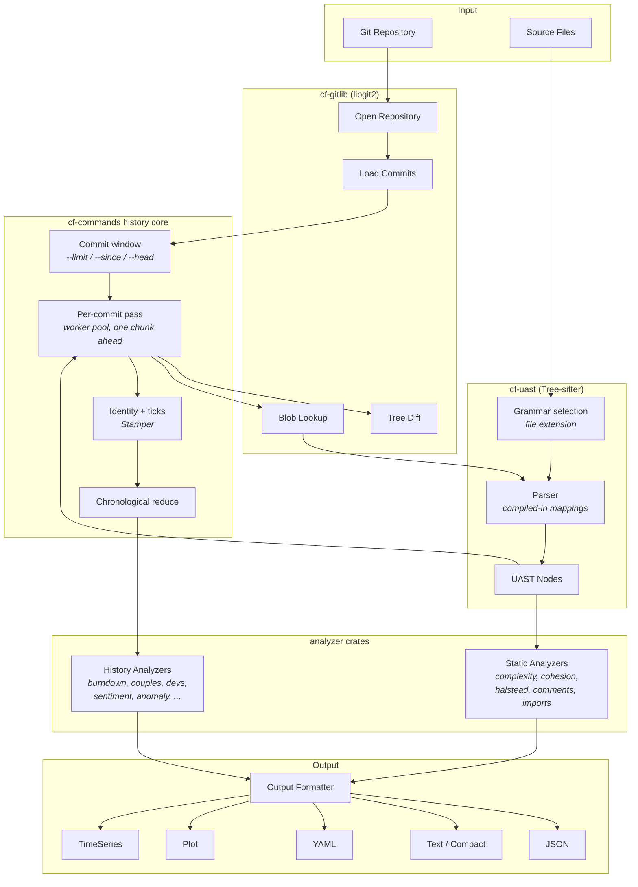
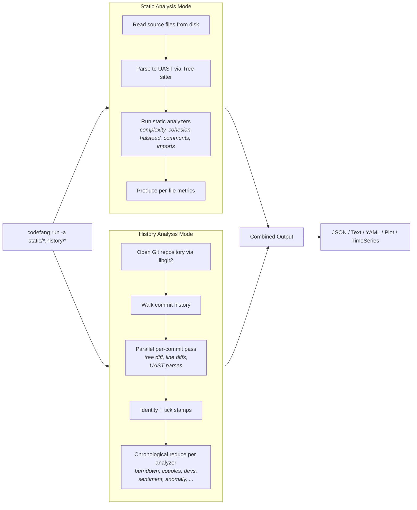

# Architecture overview

Codefang follows the **Unix philosophy**: small, focused tools joined by pipes.
The project ships two binaries that can be used independently or composed
together in pipelines, CI systems, and AI agent workflows.

## Two binaries

| Binary | Purpose | Entry point |
|--------|---------|-------------|
| `uast` | Parse source code into Universal Abstract Syntax Trees | `bins/uast/` |
| `codefang` | Run static and history analyzers on code and repositories | `bins/codefang/` |

Both CLIs are thin entrypoints over the shared workspace crates: the `cf-uast*`
crates for parsing and `cf-commands` plus the per-analyzer crates for analysis.

```bash
# Parse a source file into UAST JSON
uast parse main.rs

# Run static complexity analysis
codefang run -a static/complexity --head .

# Run git history analysis
codefang run -a history/burndown,history/devs --limit 50 .
```

---

## Package structure

### CLI layer

| Crate | Description |
|-------|-------------|
| `bins/codefang` | CLI entry point for the analyzer. Subcommands `run`, `render`, `version`, `completion`. Delegates to `cf-commands`. |
| `bins/uast` | CLI entry point for the UAST parser. Subcommands `parse`, `diff`, `query`, `explore`, `analyze`, `validate`, `mapping`, `completion`, `version`. |

### Core libraries (workspace crates)

The Rust port is a workspace of small, single-responsibility crates (`cf-*`).
The ones the binaries link:

| Crate | Description |
|-------|-------------|
| `cf-uast` | UAST parser engine: Tree-sitter integration, rule lowering, grammar selection by extension. |
| `cf-uast-node`, `cf-uast-mapping`, `cf-uast-mappings`, `cf-uast-spec` | UAST node model, the mapping model and macro, the compiled-in language mappings, the schema. |
| `cf-commands` | The `codefang` command tree and bodies: the analyzer registry, the shared static walk, the shared history core, every output format. |
| `cf-gitlib` | Git operations via the `git2` crate (vendored libgit2): repository, revwalk, tree diff with rename detection, blobs, line diffs. |
| `cf-analyzers-plumbing`, `cf-identity` | The shared history tick assigner (`HistoryTicks`) and author identity detector. |
| `cf-langpath`, `cf-pathpolicy`, `cf-pathfilter` | Language detection (an enry / Linguist port) and the vendored / generated path policy shared by both phases. |
| `cf-alg`, `cf-alg-stats`, `cf-alg-mapx`, `cf-alg-levenshtein`, … | Generic algorithms, statistics and map/slice helpers used across analyzers. |
| `cf-gojson`, `cf-goyaml`, `cf-reportutil`, `cf-analyze` | The report encoders (JSON, YAML, the CFB1 binary envelope) and the unified `codefang.run.v1` model — the only path report output may use, so machine-format bytes stay stable across releases. |
| `cf-renderer`, `cf-terminal`, `cf-plotpage` | Terminal `text` / `compact` rendering and the HTML `plot` pages. |
| `cf-safeconv` | Safe numeric conversions (clamp / checked / extract) used across the workspace. |
| Analyzer crates (`cf-complexity`, `cf-cohesion`, `cf-halstead`, `cf-comments`, `cf-imports`, `cf-clones`, `cf-composition`, `cf-analyzer-burndown`, `cf-burndown-core`, `cf-couples`, `cf-devs`, `cf-file-history`, `cf-sentiment`, `cf-shotness`, `cf-typos`, `cf-anomaly`, `cf-quality`) | One crate per analyzer's logic. |

`codefang` also links `cf-mcp` (the `codefang mcp` server), `cf-streaming`,
`cf-budget`, `cf-framework`, `cf-units` (the history memory budget),
`cf-meminfo` (heap release), `cf-persist` (the UAST results spill) and
`cf-config` (the configuration file). Neither binary links `cf-checkpoint`,
`cf-storage`, `cf-spillstore`, `cf-cache`, `cf-observability`,
`cf-plumbing`, `cf-analyzers-common`, `cf-alg-bloom`,
`cf-alg-cms`, `cf-alg-interval` or `cf-alg-lru` (`cargo tree -p codefang`,
`cargo tree -p uast`).

### Analyzers

#### Shared history core

Every history analyzer runs through one shared core in `cf-commands`
(`crates/cf-commands/src/handlers/history/mod.rs`): one commit window, one
tree diff with rename detection, one change filter, one identity and tick
assignment and one chronological reduce. See
[History pipeline](streaming-pipeline.md).

| Component | Purpose |
|-----------|---------|
| `HistoryRun` | The opened repository, the oldest-first commit window and the change filter |
| `walk_chunks` + worker pool (`history/chunks.rs`, `history/pool.rs`) | The pure per-commit pass (tree diff, line stats, blob reads, UAST parses) on a worker pool at most one chunk ahead of the in-order fold |
| `Stamper` | The ONE identity + tick assignment, one commit at a time in window order |
| Memory budget (`history/budget.rs`) | `--memory-budget` / `--chunk-size` → each walk's chunk size and worker count |
| `HistoryFilter` | `--languages`, vendored / generated policy, the generated-code marker |
| `IdentityDetector` (`cf-analyzers-plumbing`) | Maps commit authors to canonical developers |
| `HistoryTicks` (`cf-analyzers-plumbing`) | Assigns monotonic tick indices (`--tick-size`) |
| Shared UAST pass (`uast_walk.rs`) | Parses each change's two sides once, one change at a time, for every selected UAST-based analyzer |

#### Static analyzers

| Analyzer | ID | Description |
|----------|----|-------------|
| Complexity | `static/complexity` | Cyclomatic complexity per function |
| Comments | `static/comments` | Comment density and documentation coverage |
| Halstead | `static/halstead` | Halstead software science metrics |
| Cohesion | `static/cohesion` | Class/module cohesion metrics |
| Imports | `static/imports` | Import graph and dependency analysis |
| Clones | `static/clones` | Near-duplicate function detection |
| Composition | `static/composition` | File categories (source, test, docs, config, …) |

`cf-commands` also holds the analyzer registry, the shared static walk and
the output formatting (JSON, YAML, binary, text, compact, NDJSON,
timeseries, plot).

#### History analyzers

| Analyzer | ID | Description |
|----------|----|-------------|
| Burndown | `history/burndown` | Code age and survival analysis |
| Couples | `history/couples` | File co-change coupling detection |
| Devs | `history/devs` | Developer contribution statistics |
| File History | `history/file-history` | Per-file change timeline |
| Sentiment | `history/sentiment` | Code comment sentiment over time |
| Shotness | `history/shotness` | Function-level change frequency |
| Typos | `history/typos` | Identifier typo detection in diffs |
| Imports | `history/imports` | Import evolution over time |
| Anomaly | `history/anomaly` | Temporal anomaly detection via Z-score |
| Quality | `history/quality` | UAST-based quality metrics over time |

---

## Data flow

The following diagram shows how data flows through the system during a
combined static + history analysis run.



---

## Two analysis modes

Codefang operates in two distinct modes that can run independently or be
combined in a single `codefang run` invocation.



### Static mode

1. Walks the source tree once per analyzer (`walk_source_files`), applying
   the vendored / generated policy, `--languages` and a 64 MiB per-file cap.
2. Parses each file into a UAST using Tree-sitter and the compiled-in
   mappings.
3. Runs the selected static analyzers (complexity, cohesion, halstead,
   comments, imports, clones, composition); up to four analyzers run
   concurrently.
4. Produces per-file and aggregate metrics.

Static analysis requires no Git history.

### History mode

1. Opens the Git repository via libgit2 through the `git2` crate.
2. Selects the commit window (`--limit` newest commits, `--since`, `--head`,
   `--first-parent`) and consumes it oldest-first.
3. Diffs every commit against its first parent with rename detection and
   applies the shared change filter and `--max-changes-per-commit`.
4. Computes each commit's pure products (line stats, blob reads, UAST
   parses) in parallel across all cores.
5. Assigns every commit its author id and tick once, then each analyzer
   reduces the products in chronological order on one thread — so the report
   is the same on any CPU count.

### Combined mode

When both static and history analyzers are selected, Codefang computes every
analyzer's report (up to four concurrently), encodes each into the internal
CFB1 binary envelope, then decodes and merges them into a single
`codefang.run.v1` document in the requested format.

---

## Pipeline architecture

There is no runner or coordinator: each history analyzer walks the commit
window in chunks (`--chunk-size`; one chunk by default) — a parallel
per-commit pass over the chunk followed by a single-threaded chronological
fold into the analyzer's reduce state — and several analyzers of one run are
computed concurrently. See [History pipeline](streaming-pipeline.md) for the
commit window, the change filter, identity and ticks, and how reports are
serialized.

---

## Configuration

A run is configured by the `codefang run` command-line flags (see the
[CLI reference](../guide/cli-reference.md)); the `cf-config` crate (typed
config, loader, compiled defaults) is not linked into the binary. See the
[Configuration reference](../guide/configuration.md).

---

## Observability

The default `codefang` binary exports no traces or metrics:
`cf-observability` is compiled only with `cf-commands`' non-default
`runtime` feature. A run reports on stderr — the resolved selection and the
elapsed time as `progress:` lines (`--silent` turns them off), each skipped
file once as a `warning:` line, and every failure as one `Error: <cause>`
line — and writes report bytes only to stdout (or to `--output` for
`plot`).
