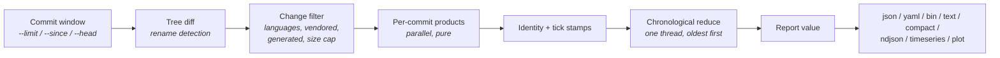

# History pipeline

Every `history/*` analyzer runs through one shared core
(`crates/cf-commands/src/handlers/history/mod.rs`): one way to select the
commit window, one tree diff, one change filter, one identity and tick
assignment, and one chronological reduce. This page follows a run through
that core in the order it executes.

Before any of this runs, one preflight (`handlers::preflight`) validates the
path, opens the repository, resolves `--since`, reads `--people-dict` and
checks every numeric flag and the format; a failure prints `Error: <cause>`
and nothing is written to stdout.

---

## 1. Commit selection

The window is computed by `load_history_commit_hashes`
(`crates/cf-commands/src/handlers.rs`) from a libgit2 revwalk that starts at
`HEAD` and is ordered by committer time with topological constraints, newest
first.

| Flag | Effect on the window |
|------|----------------------|
| `--since <time or revision>` | Keeps the commits whose **author** time is at or after the cutoff. A revision (`v1.2.0`, `HEAD~100`, a SHA) uses that commit's author time. Author time can be skewed against the committer-time order, so the cutoff is a skip filter over the whole walk, never a stop condition. A cutoff newer than `HEAD` gives an empty window and empty reports. |
| `--limit N` | Keeps the **N newest** commits that pass `--since` (the `git log -n` convention); `0` keeps all. |
| `--head` | The window is exactly `[HEAD]` — byte-identical to `--limit 1` for every analyzer and format. |
| `--first-parent` | libgit2 first-parent simplification: side branches are not walked, and a merge is treated as an ordinary single-parent commit. |

The selected hashes are then **reversed**: every analyzer consumes the window
oldest-first, because tick assignment, identity ids and burndown's line
survival depend on history order.

`history/burndown` always walks first-parent (`HistoryRun::open_first_parent`):
its line-survival tracking follows the main line of development. This is
burndown's own walk; analyzers selected next to it keep the user's
`--first-parent` setting. In a `--limit`, `--since` or `--head` window,
burndown seeds its tracked lines from the window's base tree (the parent of
the first in-window commit), so a commit's added and removed lines are the
lines it changed.

A shallow clone yields an empty walk (`cf_gitlib::Repository::log`).

---

## 2. Tree diff with rename detection

Each commit is diffed against its first parent (`commit_tree_changes`); a
root commit lists every file of its tree as an insertion. The diff uses
libgit2's tree diff followed by `git_diff_find_similar` with renames enabled
(libgit2's default 50 % similarity, the `git diff -M` behaviour), so a moved
file is ONE change from the old path to the new path instead of a delete plus
an add (`cf_gitlib::Repository::diff_tree_to_tree`). That keeps a file's
identity across renames: burndown moves the file's line history, couples
carries its co-change row, file-history carries its commit list, and devs
counts a pure `git mv` as zero added and zero removed lines.

Commits whose trees are identical produce no changes. Type changes and
unreadable deltas are skipped.

---

## 3. The change filter

`HistoryFilter` (`crates/cf-commands/src/handlers.rs`) decides, per change,
whether any analyzer sees it. It uses the same path policy as the static
phase:

- **Vendored paths** (detected by the Linguist rules: `vendor/`,
  `node_modules/`, `third_party/`, `testdata/`, minified bundles, …) are
  excluded unless `--include-vendored` is set.
- **Generated files** are excluded unless `--include-generated` is set: by
  name (`*.pb.go`, `zz_generated_*.go`, `*_pb2.py`, `*.min.js`, …) and by a
  generated-code marker (`DO NOT EDIT`, `Code generated`, …) in the first
  512 bytes of the blob (`GENERATED_MARKER_HEADER_BYTES`).
- **`--extra-excluded-prefixes`** adds path prefixes to exclude.
- **`--languages`** keeps only the listed languages. The language is detected
  from the path AND the blob content, so `.h` resolves by content and an
  extensionless script by its shebang. An absent flag, an empty value or
  `all` means no restriction.

**`--max-changes-per-commit N`** (default 10 000 when `0`) drops a commit
whose raw tree diff — before the filter — has more than `N` changes. The
commit is removed before identity and ticks are assigned, so it consumes no
author id and advances no tick, and every history analyzer applies the same
rule (`Gated` / `gated_product` in `history/mod.rs`): all of them see the
same commit set, whether an analyzer runs alone or next to others. Couples additionally keeps its own
changeset cap (1 000 files): a commit above it still owns the files it
touched but adds no co-change pairs.

---

## 4. Per-commit products in parallel

The expensive, order-independent work — tree diffs, line diffs, blob reads,
language detection, UAST parses — runs on a worker pool
(`prepare_in_order`, `history/pool.rs`):

- a fixed set of worker threads lives for the whole walk; each opens its OWN
  `Repository` once (libgit2 handles cannot cross threads) and keeps one
  thread-local UAST parser (`UAST_PARSER`), so setup is paid once per thread;
- workers claim short runs of consecutive commits (up to 32) from a shared
  cursor: consecutive commits share most of their trees, which the claiming
  worker's libgit2 object cache then still holds (`history/anomaly` on
  31,923 kubernetes commits: 65 s claiming one commit at a time, 32 s with
  runs);
- a worker with nothing left to claim takes the unstarted back half of
  another worker's run, so a cluster of slow commits (vendoring, mass
  renames) is shared out instead of serialized behind one worker;
- the function run per commit is **pure**: its result depends only on that
  commit, never on another commit's result;
- the calling thread folds the products in window order as they arrive; a
  fatal git error on any commit aborts the run, and a panicking commit
  panics the run with its own message.

### Chunks

A worker may claim a commit only while it is less than one chunk ahead of
the fold, so at most one chunk of products is alive at once
(`walk_chunks`, `history/chunks.rs`). The chunk is a sliding bound, not a
barrier: no worker waits for the slowest commit of a chunk. Each kept commit
is stamped and folded into the analyzer's reduce state in window order and
its product is freed. The fold sees the same commits in the same order
whatever the chunk size or worker count, so the output is byte-identical for
every `--chunk-size` and `--memory-budget`
(`bins/codefang/tests/chunked_history_e2e.rs`). Every history walk folds
this way. Burndown first stamps every kept commit (the value packing needs
the last tick before its first line is attributed), then prepares each
change's facts on the pool — the blob line counts, the binary check, the
change filter and the line diff against the From blob — and folds them into
its per-file treaps in commit order; a precomputed diff is used only while
the From path's tracked length matches the From blob, exactly the
sequential rule. The raw-count pre-pass keeps the tree diffs of commits
with 256 or more changes for the main pass, so their rename detection runs
once (`history/burndown` on 31,923 kubernetes commits: 59.4 s → 25.9 s).

After every chunk of folded commits, and when the walk ends, free heap pages
go back to the operating system (`cf_meminfo::release_free_heap`,
`malloc_trim(0)` on glibc). glibc otherwise keeps every worker's allocator
arena at its largest transient working set: on the 7,973-commit kubernetes
prefix a forced trim dropped `history/sentiment` from 1777 MB to 679 MB
resident mid-run.

### The memory budget

`--memory-budget` (default: half the physical RAM, at most 2 GiB) plans each
walk (`history/budget.rs`):

1. `--chunk-size` wins when given; the walk then runs one worker per core.
2. The history walks that run at once (the selected history analyzers, the
   five UAST analyzers counting once, at most four) share the budget.
3. libgit2 gets a fixed part first: a quarter of the budget for its object
   cache, shared by every repository handle (its 256 MiB default made the
   parallel walks evict each other's trees: the five non-UAST walks over
   31,923 kubernetes commits ran 183 s with it, 109 s with 512 MiB), and
   7.5 % for mapped pack windows (the Go split; without a cap libgit2 keeps
   up to 8 GiB mapped, every touched page resident). Both are set once,
   before the first repository opens.
4. A fixed base (128 MiB: the binary and the embedded parsers) is paid once.
   The walks that run at once share the rest (the pre-computed UAST pass
   runs alone and gets all of it); half of a walk's share is reserved for
   worker working sets. Each walk has a measured cost per worker and per
   in-flight product (`DEVS_COST`, `ANOMALY_COST`, …, recorded next to each
   walk with the measurement it comes from), so the worker count is as many
   as the reserve holds (at least one, at most the cores) and the chunk is
   what `cf_streaming::Planner` fits in the other half (at least two
   products per worker, at most the window).

`-v` prints each walk's plan, for example
`progress: history/devs plan: 3000 commits per chunk, 11 chunks, 24 workers (budget 2048 MiB)`.

The budget bounds what a walk holds in flight; the analyzers' own reduce
state (per-commit records the per-commit formats emit, per-file and
per-developer aggregates) still grows with the window.

### Blob size caps

| Cap | Value | Applies to |
|-----|-------|------------|
| `MAX_BLOB_SIZE` (`uast_walk.rs`) | 256 KiB | A larger blob is not parsed into a UAST (imports, quality, sentiment, shotness, typos skip it). Line-based analyzers still count it. |
| Content classification (`file_history.rs`) | first 8 KiB | File-history classifies a file by its path and its blob header (binary, generated). |
| Generated marker | first 512 bytes | The change filter above. |

### The shared UAST walk

The five UAST-based analyzers (`history/imports`, `quality`, `sentiment`,
`shotness`, `typos`) run as ONE chunked pass, whether one or several of them
are selected (`crates/cf-commands/src/handlers/uast_walk.rs`): each commit's
diff is computed once, and each change's two sides are read and parsed at
most once and shared by every selected analyzer (`ChangeParses`). A worker
holds the parses of one change at a time, never a whole commit's: the
largest kubernetes commits parse megabytes of source, and holding them all
was what drove the UAST analyzers' memory. The pass applies the same flags
to every analyzer (drop gate, `--first-parent`, the shotness DSL), so an
analyzer's report does not depend on which others are selected. The pass is
memoized for the process with only its finished per-analyzer records, so
every output path of the run (several formats, the plot pages) reuses it.

When other history walks run after the pass, the finished records would
share memory with them while nobody reads them until rendering (on 31,923
kubernetes commits: 2.2 GB of the 4.9 GB peak). The memo then spills each
analyzer's records to an unlinked temporary file in `TMPDIR`
(`handlers/spill.rs`, bincode through `cf_persist::GobCodec`), and each
consumer reads back only its own analyzer when it renders. The files have no
name, so their space is reclaimed when the process exits. On a host whose
`/tmp` is `tmpfs`, the spill leaves the process but stays in RAM; point
`TMPDIR` at a disk to free it. `-v` prints the size of every spill.

---

## 5. Identity and ticks

`Stamper` (`history/chunks.rs`) assigns each kept commit its author id and
its tick, one commit at a time, oldest-first, as the walk folds it. Both
depend only on the commits stamped before, never on the chunk boundaries, so
all analyzers agree on who and when.

**Identity** (`IdentityDetector`, `cf-analyzers-plumbing`). By default a
commit whose author email OR name matches a known developer is that
developer, and the other token is registered too, so `alice <a@x>`,
`Alice Smith <a@x>` and `Alice Smith <a@y>` are one person. Ids are assigned
in first-seen order, oldest commit first.

| Flag | Effect |
|------|--------|
| `--exact-signatures` | Match on the full `name <email>` signature instead. |
| `--people-dict <file>` | Map signatures to people from a file (an unreadable file is an error). |
| `--anonymize` | Report developers as `Developer-A`, `Developer-B`, … |

**Ticks** (`HistoryTicks`). The first commit's committer time, floored to the
tick size, is tick 0; every commit's tick is
`max(floor((time - tick0) / size), previous tick)`, so ticks never go
backwards even when committer clocks do. `--tick-size` sets the size in
hours (default 24, must be greater than 0). The assignment is a pure function
of the commit times: no wall clock is consulted.

---

## 6. The chronological reduce

Each analyzer then folds its per-commit products into its report on ONE
thread, in window order: burndown applies each commit's line edits to its
per-file treaps, couples accumulates co-change and ownership matrices over
one exact set of seen files, file-history maintains per-path commit lists,
shotness runs its per-function state machine, typos keeps each pair's first
fix.

The split is deliberate. State that depends on history order — line
survival, rename chains, first-seen identities, "first occurrence" lists —
must be applied oldest-first, and keeping all parallelism in the pure
per-commit stage makes every report a pure function of the repository and
the flags: the same bytes on 2 CPUs or 64. The end-to-end test
`output_does_not_depend_on_the_host_cpu_count`
(`bins/codefang/tests/history_core_e2e.rs`) pins this by running under
`taskset -c 0-1`.

A merge commit (when not walking first-parent) is diffed against its first
parent like any commit; each analyzer decides what a merge contributes — for
example devs attributes no line stats to it, and couples counts only the
files no earlier commit of the window changed.

---

## 7. Several analyzers in one run

Each analyzer computes its own walk (except the shared UAST walk above). The
analyzers of one selection are independent, so up to four are computed
concurrently (`ANALYZER_CONCURRENCY`), and their outputs are always written
in a fixed order.

---

## 8. Serialization

The reduce produces one report value per analyzer; every format encodes that
value, through `cf-gojson` / `cf-goyaml` so key order and number formatting
are stable.

| Format | One analyzer | Several analyzers |
|--------|--------------|-------------------|
| `json`, `yaml` | The analyzer's report. | ONE `codefang.run.v1` document: `{"version", "metadata", "analyzers": [{"id", "mode", "report"}]}` — the same shape as a mixed static + history run. |
| `bin` | A CFB1 envelope around the JSON value. | One envelope per analyzer. |
| `text` | A version header, `<id>:`, then the analyzer's human summary. | The header once, one section per analyzer. |
| `compact` | One line: id, `Info`, the key figures. | One line per analyzer. |
| `ndjson` | One line per per-commit record: `{"hash", "tick", "author_id", "timestamp", "analyzer", "data"}`. | Every analyzer's records merged by commit position. |
| `timeseries` | A `codefang.timeseries.v1` document: per commit `{hash, timestamp, author, tick, <analyzer>: …}`. | The per-commit values of every analyzer merged into one entry per commit. |
| `timeseries --ndjson` | The document's `commits`, one line per commit. | Same, merged. |
| `plot` | `<page>.html`, `index.html` and `report.json` in `--output`. | One page per analyzer, one index. |

Every whole-selection renderer builds its complete output before anything is
written: if an analyzer cannot produce its report, the run prints
`Error: <cause>` and stdout stays empty.

---

## Observing a run

Unless `--silent` is set, the run prints two progress lines on stderr: the
resolved selection (`progress: resolved analyzers: static=… history=…
output_format=…`) and the elapsed time (`progress: run finished in …`).
Report bytes only ever go to stdout (or to `--output` for `plot`).

---

## What the pipeline does not do

The `codefang` binary spills only the finished UAST results; it does not
hibernate a walk's in-progress state between chunks, has no
checkpoint/resume and no prefetch buffering, and it exports no tracing spans
or metrics. The workspace crates that model those ideas (`cf-checkpoint`,
`cf-spillstore`, `cf-observability`) are not linked into it. The memory budget bounds what the walks hold in flight; the reduce
state of very long windows still grows with the window, so on a very large
repository narrow it with `--limit` or `--since`, or select fewer analyzers.
