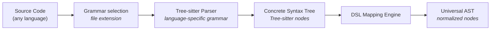
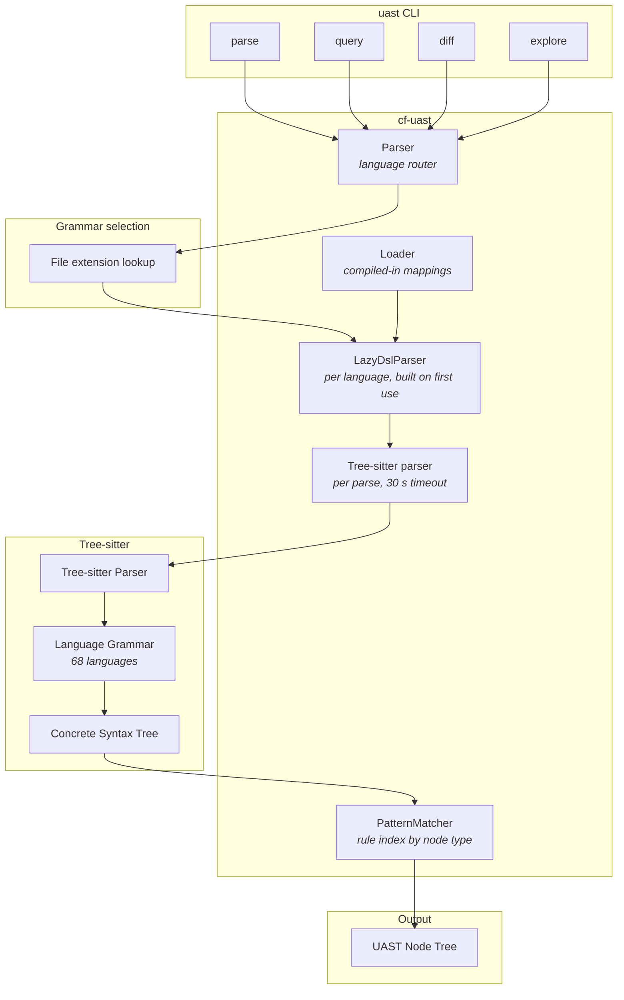

# UAST system

The **Universal Abstract Syntax Tree** (UAST) is Codefang's language-agnostic
code representation. It normalizes the wildly different ASTs produced by
language-specific parsers into a common schema with consistent node types,
roles, and properties -- enabling analyzers to work across the 68
compiled-in languages with a single implementation.

---

## What is UAST?

A UAST is a tree of nodes where each node has:

| Field | Type | Description |
|-------|------|-------------|
| `type` | string | Semantic node type: `Function`, `Class`, `Import`, `Expression`, etc. |
| `token` | string | The literal text token (for leaf nodes) |
| `roles` | list | Semantic roles: `Declaration`, `Function`, `Statement`, `Expression`, etc. |
| `pos` | object | Source positions: start/end line, column, byte offset |
| `props` | map | Key-value properties (e.g., `name`, `visibility`) |
| `children` | list | Child UAST nodes |

Example UAST node for a Go function:

```json
{
  "type": "Function",
  "token": "processData",
  "roles": ["Declaration", "Function"],
  "pos": {
    "start": { "line": 10, "col": 1, "offset": 245 },
    "end": { "line": 25, "col": 2, "offset": 612 }
  },
  "props": {
    "name": "processData"
  },
  "children": [...]
}
```

---

## Tree-sitter under the hood

Codefang uses [Tree-sitter](https://tree-sitter.github.io/) as the parsing
backend. Tree-sitter provides:

- **Incremental parsing** -- only re-parses changed regions
- **Error recovery** -- produces partial trees even for malformed code
- **68 language grammars** compiled into the binary: the grammar C sources are
  vendored under `crates/cf-uast/vendor/` (taken from
  [go-sitter-forest](https://github.com/alexaandru/go-sitter-forest)) and
  built by `crates/cf-uast/build.rs`
- **Zero runtime dependencies** -- all grammars are statically linked

The parsing flow:



### Grammar selection

The parser (`cf_uast::Parser`) picks the grammar from the file's
**extension** (lower-cased), looked up in the registry of compiled-in
mappings behind a small bloom filter (`crates/cf-uast/src/loader.rs`). There
are no content heuristics: a file without a mapped extension (for example a
`Makefile`) is not parsed. `uast parse -l <language>` forces the grammar.

The `codefang` language filter (`--languages`) and its per-language
breakdowns are a separate step: they use `cf-langpath`, a port of the
enry / Linguist cascade over the file name AND its content (shebangs,
`.h` disambiguation).

### Performance characteristics

- **Lazy per-language setup**: each language's parser state (tree-sitter
  language, resolved rules, pattern matcher) is built on its first parse and
  then shared (`LazyDslParser`, a `OnceLock`).
- **O(1) rule lookup**: rules are indexed by the tree-sitter node type they
  match (`rule_dispatch`), so lowering never scans the rule list.
- **One parser facade per worker thread** in history walks: the parallel
  per-commit pass keeps a thread-local `cf_uast::Parser`
  (`crates/cf-commands/src/handlers/history/mod.rs`), so registry and loader
  setup is paid once per thread.
- **Parse watchdog**: every tree-sitter parse has a 30 s timeout
  (`PARSE_TIMEOUT_MICROS`); a fresh tree-sitter parser is created per parse.

---

## DSL mapping engine

The mapping rules are how Tree-sitter's language-specific concrete syntax
tree nodes are mapped to universal UAST node types. The compiled-in languages
keep their rules as Rust tables, one module per language in
`crates/cf-uast-mappings/src/` (built with the `uast_language!` macro); the
text DSL below expresses the same rule model and is the format for custom
mappings (`uast mapping`, `cf_uast::Parser::with_map`).

### DSL syntax overview

A mapping file consists of:

1. A **language declaration** with name and file extensions.
2. One or more **mapping rules** that match Tree-sitter node types and produce UAST nodes.

```text
language go [.go]

function_declaration <- (function_declaration
    name: (identifier) @name
    body: (block) @body
) => uast(
    type: "Function",
    token: "@name",
    roles: "Declaration", "Function",
    children: "@body"
)
```

### Rule anatomy

Each rule has four parts:

```text
<rule_name> <- (<tree-sitter-pattern>) => uast(<uast-spec>)
```

| Part | Description |
|------|-------------|
| `rule_name` | The Tree-sitter node type this rule matches (e.g., `function_declaration`) |
| `tree-sitter-pattern` | A Tree-sitter query pattern with named captures (`@name`, `@body`) |
| `uast-spec` | The UAST node specification: type, token, roles, props, children |

### UAST spec fields

| Field | Description | Example |
|-------|-------------|---------|
| `type` | UAST node type | `"Function"`, `"Class"`, `"Import"` |
| `token` | Token extraction source | `"@name"`, `"self"`, `"text"`, `"fields.name"`, `"child:identifier"`, `"descendant:identifier"` |
| `roles` | Comma-separated semantic roles | `"Declaration", "Function"` |
| `props` | Key-value properties: `@capture`, `descendant:<kind>`, or a literal | `name: "@name", operator: "?:"` |
| `children` | Child capture reference | `"@body"` |

### Token sources

| Source | Description |
|--------|-------------|
| `@capture_name` | Text from a named capture in the Tree-sitter pattern |
| `self` / `text` | The full text of the matched node |
| `fields.name` | The `name` field of the Tree-sitter node |
| `child:<type>` | Text of the first child of the specified type |
| `descendant:<type>` | Text of the first descendant of the specified type |

### Conditions

Rules can include conditions that filter matches:

```text
public_method <- (method_declaration
    name: (identifier) @name
) where (visibility == "public") => uast(
    type: "Function",
    token: "@name",
    roles: "Declaration", "Function", "Public"
)
```

Conditions support `==` and `!=` operators, comparing fields, captures, or
child types against string literals. A dotted path navigates the tree-sitter
structure — `value.type == "arrow_function"` compares the `value` field's node
kind — and a leading `parent` segment steps to the enclosing node:
`parent.type == "variable_declarator"` selects the rule only when the node is
the value of a declarator. Several rules may share one node kind; the first
whose conditions pass wins and an unconditional rule is the catch-all.

### Inheritance

Rules can extend other rules to avoid duplication:

```text
base_function <- (function_declaration) => uast(
    type: "Function",
    roles: "Declaration", "Function"
)

arrow_function <- extends base_function (arrow_function) => uast(
    type: "Function",
    roles: "Declaration", "Function", "Lambda"
)
```

The child rule inherits all fields from the base rule and can override any of
them. Inheritance is resolved recursively.

---

## Role system

UAST roles classify what a node **does** semantically, independent of language
syntax. A single node can have multiple roles.

### Common roles

| Role | Description | Examples |
|------|-------------|---------|
| `Declaration` | Declares a new name | Function def, class def, variable def |
| `Function` | Function-related | Function declaration, function call |
| `Expression` | An expression | Binary expression, call expression |
| `Statement` | A statement | If, for, return, assignment |
| `Type` | Type-related | Type annotation, type parameter |
| `Literal` | A literal value | String, number, boolean |
| `Comment` | A comment | Line comment, block comment |
| `Import` | An import | Import statement, require call |
| `Identifier` | A name reference | Variable name, function name |
| `Operator` | An operator | `+`, `-`, `==`, `&&` |
| `Call` | A function/method call | `foo()`, `obj.method()` |
| `Return` | Return from function | `return x` |
| `Assignment` | Value assignment | `x = 5`, `let y = ...` |
| `Condition` | Conditional logic | `if`, `switch`, ternary |
| `Loop` | Iteration | `for`, `while`, `forEach` |
| `Class` | Class/struct definition | `class Foo`, `struct Bar` |
| `Public` | Public visibility | Public methods, exported functions |
| `Private` | Private visibility | Private methods, unexported functions |
| `Lambda` | Anonymous function | Arrow functions, closures |

---

## Shape contract

Analyzers read the UAST, never the language. The guarantees below hold for
every language; the language-agnostic ones are implemented once in the
lowering (`crates/cf-uast/src/lowering.rs`) and pinned by
`crates/cf-uast/tests/lowering_contract.rs`, the per-language ones by
`crates/cf-uast-mappings/tests/shape_contract.rs`.

### Operators

Every `BinaryOp`, `UnaryOp` and `Assignment` node (plain and compound) and
every conditional expression carries `props.operator`: the operator's source
spelling (`+`, `&&`, `and`, `not in`, `=`, `+=`, `++`). It is resolved, in
order, from the rule's own `operator` prop, the grammar's `operator` / `op` /
`operation` field, the space-joined repeated `operators` field (a Python chain
`a < b <= c` reports `< <=`), and — for the three operator types only — the
first anonymous child token. Ternaries are `If` nodes with role `Condition`
and `operator` `?:` (`if-else` for Python's `x if c else y`). The node
`token` of an operator node is not part of the contract; read `operator`.

### Tokens

`Identifier` and `Literal` nodes always carry their source text as `token`
(including string quotes). A `Comment` is a **leaf** whose `token` is the
comment text and whose span never includes the trailing line terminator;
documentation comments (`///`, `//!`, `/** */`, Python docstrings) carry the
role `Doc`. The `token` of a declaration node, when a table sets one, is the
declared name (C/C++ functions, Java types, JS/TS class-field functions);
some tables inherited from the DSL corpus still set the full declaration
text (Go, Rust and Java functions) — slice the source through `pos` instead
of relying on either.

### Names

Every `Function`, `Method`, `Class`, `Struct`, `Interface` and `Enum`
declaration carries `props.name`, and there is exactly **one** such node per
declaration: bodies are `Block`s, declarators and parameter-type lists are
structural, and a function-typed parameter (`func(int) int`) or a prototype
is never a `Function`. Named function values (`const f = () => {}`,
`handler = () => {}`) are a single `Function` / `Method` named after the
binding; an anonymous function value is a `Lambda`.

### Branches and loops

An `If`'s children are its condition expression(s), the consequence `Block`
(role `Body`) and, when present, the alternative — the child lowered from the
tree-sitter `alternative` field — which carries the role `Else`. An
else-if chain is therefore an `If` **directly** under an `If` with roles
`Condition, Else`; a final else is a `Block` with roles `Body, Else`
(`Else` lands on whatever the alternative lowers to, including a bare
statement in C/Java/JS). Grammars with an `else_clause` wrapper (C, C++,
Rust, JavaScript, TypeScript) leave it unmapped so the wrapper collapses;
Python's `elif_clause` / `else_clause` set the roles explicitly. Each loop
statement is exactly one `Loop`; where the table knows the loop kind it is
`props.kind` (`for`, `while`, `do-while`, `for-in`, `loop`). Every
`case` / `default` label is one `Case` with role `Branch`; `Switch` is the
statement only.

---

## Writing custom mappings

To add or customize language mappings:

### Step 1: create a mapping file

Create a `.uast` file for your language:

```text
language rust [.rs]

fn_item <- (function_item
    name: (identifier) @name
    body: (block) @body
) => uast(
    type: "Function",
    token: "@name",
    roles: "Declaration", "Function",
    children: "@body"
)

struct_item <- (struct_item
    name: (type_identifier) @name
    body: (field_declaration_list) @body
) => uast(
    type: "Class",
    token: "@name",
    roles: "Declaration", "Class",
    children: "@body"
)

impl_item <- (impl_item
    type: (type_identifier) @name
    body: (declaration_list) @body
) => uast(
    type: "Class",
    token: "@name",
    roles: "Declaration", "Class", "Implementation",
    children: "@body"
)

use_declaration <- (use_declaration
    argument: (_) @path
) => uast(
    type: "Import",
    token: "@path",
    roles: "Import"
)

line_comment <- (line_comment) => uast(
    type: "Comment",
    token: "self",
    roles: "Comment"
)
```

### Step 2: test with the UAST CLI

```bash
# Parse a file with your custom mapping
uast parse --language rust main.rs

# Explore the raw Tree-sitter AST to discover node types
uast explore main.rs

# Query specific node types
uast query 'rfilter(.type == "Function")' main.rs
```

### Step 3: iterate

Use `uast explore` to inspect the Tree-sitter CST and discover which node
types and field names are available for your target language. Then write
mapping rules to convert them to UAST types.

### Pre-compiled mappings

The built-in language mappings are compiled into the binary as Rust tables
(`crates/cf-uast-mappings`); nothing is read from disk at run time. Each
language's rules are resolved once, on its first parse, together with its
`PatternMatcher` and the node-type rule index.

---

## UAST CLI commands

The `uast` binary's commands for working with Universal ASTs are below; it
also provides `analyze`, `validate`, `mapping`, `completion` and `version`
(`uast --help`).

### `uast parse`

Parse source files into UAST format.

```bash
uast parse main.go                      # Parse a single file
uast parse *.go                          # Parse multiple files
uast parse -l python script.py           # Force language
uast parse -f json -o output.json main.go  # JSON to file
uast parse --all                         # Parse entire codebase
cat main.go | uast parse -               # Parse from stdin
```

| Flag | Description | Default |
|------|-------------|---------|
| `-l, --language` | Force language detection | auto-detect |
| `-o, --output` | Output file path | stdout |
| `-f, --format` | Output format: `json`, `compact` | `json` |
| `-p, --progress` | Show progress for multiple files | `false` |
| `--all` | Parse all source files recursively | `false` |

### `uast query`

Query UAST nodes using filter expressions.

```bash
uast query 'rfilter(.type == "Function")' main.go
uast query 'rfilter(.roles has "Declaration")' -i ast.json
uast query --interactive main.go         # REPL mode
```

| Flag | Description | Default |
|------|-------------|---------|
| `-e` | Query expression | (required) |
| `-i, --input` | Input UAST JSON file | (parse from source) |
| `-f, --format` | Output format: `json`, `compact` | `json` |
| `--interactive` | Interactive REPL mode | `false` |

### `uast diff`

Compare UAST trees of two files.

```bash
uast diff old_version.go new_version.go
uast diff -f json file_v1.py file_v2.py
```

| Flag | Description | Default |
|------|-------------|---------|
| `-o, --output` | Output file path | stdout |
| `-f, --format` | Output format: `json`, `compact` | `json` |

### `uast explore`

Interactively explore the AST structure of a file.

```bash
uast explore main.go                     # Explore full AST
uast explore -l python script.py         # Force language
```

| Flag | Description | Default |
|------|-------------|---------|
| `-l, --language` | Force language detection | auto-detect |

---

## Architecture diagram



---

## Integration with analyzers

The UAST system is used by both static and history analyzers:

**Static analyzers** parse source files directly:

- `static/complexity` -- counts decision points in `Function` nodes
- `static/cohesion` -- measures method coupling within `Class` nodes
- `static/halstead` -- counts operators and operands across the tree
- `static/comments` -- measures `Comment` node density relative to code
- `static/imports` -- extracts `Import` nodes for dependency graphs

**History analyzers** parse the changed blobs of every commit:

- `history/sentiment` -- analyzes sentiment of the `Comment` nodes a commit
  introduced or changed
- `history/shotness` -- tracks change frequency of `Function` nodes
- `history/typos` -- detects identifiers a commit renamed into a
  Levenshtein-close spelling
- `history/imports` -- records the imports each developer adds
- `history/quality` -- tracks UAST-based quality metrics over time

Each commit's changed files are parsed in the parallel per-commit pass of the
[history pipeline](streaming-pipeline.md), one change at a time: both sides
of a change are parsed at most once, shared by every selected UAST analyzer,
and dropped before the next change (`ChangeParses` in
`crates/cf-commands/src/handlers/uast_walk.rs`); blobs over 256 KiB are not
parsed. One pass parses for all the selected UAST analyzers.
