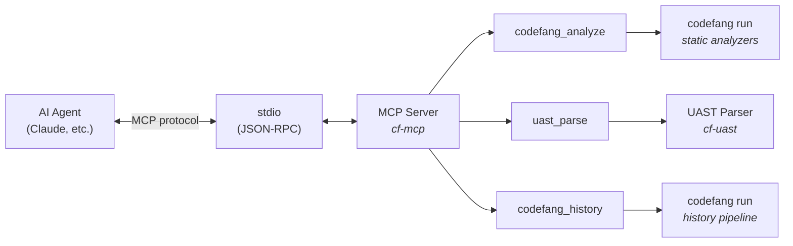

# MCP server

Codefang includes a [Model Context Protocol](https://modelcontextprotocol.io/)
(MCP) server that exposes its analysis capabilities as tools that AI agents
can discover and invoke programmatically.

---

## What is MCP?

The **Model Context Protocol** is an open standard for connecting AI assistants
to external tools and data sources. It defines a JSON-RPC protocol over
stdio transport that allows AI agents to:

1. **Discover** available tools and their schemas.
2. **Invoke** tools with structured parameters.
3. **Receive** structured results.

Codefang's MCP server turns code analysis into a first-class tool that any
MCP-compatible agent can use without manual setup.

---

## Quick start

Start the MCP server:

```bash
codefang mcp
```

The server communicates over **stdio** (stdin/stdout) using JSON-RPC, which is
the standard MCP transport for local tool use. Agents connect by launching
the process and reading/writing to its stdio streams.

Every tool runs the CLI's own pipeline, so a tool returns the report `codefang run`
renders for the same input: `codefang_analyze` returns
`{analyzer: report}` with each report equal to
`codefang run -a static/<analyzer> --format json` over the snippet, and
`codefang_history` returns `{analyzer: report}` with each report equal to
`codefang run -a history/<analyzer> --format json --limit <limit>` over the
repository. The server holds no results between calls. Errors and the
server's own failures go to stderr; stdout carries only JSON-RPC.

---

## Available tools

The MCP server exposes three tools:

| Tool | Description |
|------|-------------|
| `codefang_analyze` | Run static analysis on inline source code |
| `uast_parse` | Parse source code into Universal AST |
| `codefang_history` | Run history analysis on a Git repository |

---

## Tool reference

### `codefang_analyze`

Run static analyzers on inline source code. Returns per-function and aggregate
metrics.

#### Parameters

| Parameter | Type | Required | Default | Description |
|-----------|------|----------|---------|-------------|
| `code` | string | **Yes** | -- | Source code to analyze (max 1 MB) |
| `language` | string | **Yes** | -- | Language name or alias (Linguist: `go`, `python`, `JavaScript`, `py`); the snippet is parsed as `code` plus the language's primary extension |
| `analyzers` | string[] | No | all | List of analyzer names to run |

#### Available analyzers

| Analyzer | Description |
|----------|-------------|
| `complexity` | Cyclomatic complexity per function |
| `comments` | Comment density and documentation coverage |
| `halstead` | Halstead software science metrics |
| `cohesion` | Class/module cohesion metrics |
| `imports` | Import graph and dependency analysis |

#### Example

```json
{
  "name": "codefang_analyze",
  "arguments": {
    "code": "package main\n\nfunc fibonacci(n int) int {\n\tif n <= 1 {\n\t\treturn n\n\t}\n\treturn fibonacci(n-1) + fibonacci(n-2)\n}\n",
    "language": "go",
    "analyzers": ["complexity"]
  }
}
```

---

### `uast_parse`

Parse source code into a Universal Abstract Syntax Tree. Optionally filter by
node type.

#### Parameters

| Parameter | Type | Required | Default | Description |
|-----------|------|----------|---------|-------------|
| `code` | string | **Yes** | -- | Source code to parse (max 1 MB) |
| `language` | string | **Yes** | -- | Language name or alias (Linguist: `go`, `python`, `JavaScript`, `py`); the snippet is parsed as `code` plus the language's primary extension |
| `query` | string | No | -- | Optional node type filter (e.g., `function_declaration`) |

#### Example

```json
{
  "name": "uast_parse",
  "arguments": {
    "code": "def hello():\n    print('world')\n",
    "language": "python",
    "query": "function_declaration"
  }
}
```

---

### `codefang_history`

Run history analysis on a local Git repository. Processes commit history and
returns analyzer-specific results.

#### Parameters

| Parameter | Type | Required | Default | Description |
|-----------|------|----------|---------|-------------|
| `repo_path` | string | **Yes** | -- | Absolute path to a Git repository |
| `analyzers` | string[] | No | all | List of history analyzer names |
| `limit` | integer | No | 1000 | Maximum number of commits to analyze |
| `since` | string | No | -- | Only analyze commits after this time (e.g., `24h`, `2024-01-01`, RFC3339) |
| `first_parent` | boolean | No | `false` | Follow only the first parent of merge commits |

#### Available analyzers

| Analyzer | Description |
|----------|-------------|
| `burndown` | Code age and survival analysis |
| `couples` | File co-change coupling detection |
| `devs` | Developer contribution statistics |
| `file-history` | Per-file change timeline |
| `imports` | Import evolution over time |
| `sentiment` | Code comment sentiment over time |
| `shotness` | Function-level change frequency |
| `typos` | Identifier typo detection in diffs |

#### Example

```json
{
  "name": "codefang_history",
  "arguments": {
    "repo_path": "/home/user/projects/myapp",
    "analyzers": ["burndown", "devs"],
    "limit": 500,
    "since": "2024-01-01"
  }
}
```

---

## Agent configuration

### Claude code

Add Codefang as an MCP server in your Claude Code settings:

=== "User settings (~/.claude/settings.json)"

    ```json
    {
      "mcpServers": {
        "codefang": {
          "command": "codefang",
          "args": ["mcp"],
          "env": {}
        }
      }
    }
    ```

=== "Project settings (.claude/settings.json)"

    ```json
    {
      "mcpServers": {
        "codefang": {
          "command": "codefang",
          "args": ["mcp"],
          "env": {}
        }
      }
    }
    ```

### Generic MCP client

Any MCP-compatible client can connect by launching the process:

```bash
# The client spawns this process and communicates over stdio
codefang mcp
```

The server advertises its tools via the standard MCP `tools/list` method.
Clients call `tools/call` with the tool name and arguments.

---

## Error handling

The MCP server returns structured errors for common failure modes:

| Error | Cause | Resolution |
|-------|-------|------------|
| `code parameter is required and must not be empty` | Missing `code` in analyze/parse | Provide source code |
| `language parameter is required and must not be empty` | Missing `language` | Specify the programming language |
| `code input exceeds maximum size` | Code > 1 MB | Reduce input size or analyze files on disk |
| `repo_path must be an absolute path` | Relative path provided | Use an absolute path |
| `repository path does not exist` | Invalid path | Verify the path exists |
| `path is not a git repository` | No `.git` directory | Ensure the path is a Git repo |
| `unsupported language` | Parser not available | Check supported languages |

Errors are returned in the MCP response with `isError: true` and a human-readable
error message in the `content` field.

---

## Architecture



The MCP server (`cf-mcp`, launched by `codefang mcp` in
`crates/cf-commands/src/mcp.rs`) renders every tool result through the CLI's
own pipeline (`cf_commands::render_run`), so the analyzers, the parser, the
memory budget and the report bytes are the CLI's. Only the transport differs:
newline-delimited JSON-RPC on stdio instead of flags and stdout.
