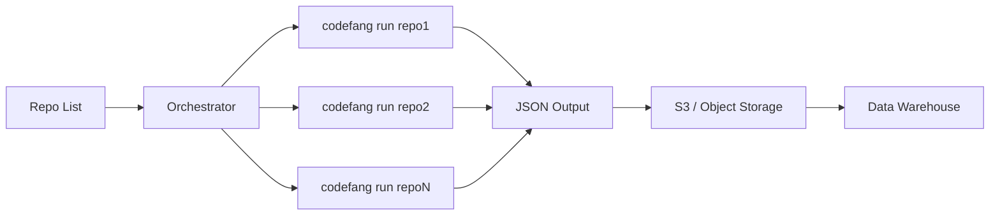

# Large-scale repository scanning

This guide covers using Codefang to periodically scan large heterogeneous
codebases — thousands of repositories — and feed results into a data warehouse
for analytics.

## Overview

Codefang operates on one repository at a time. Scanning many repositories
requires external orchestration that invokes `codefang run` per repo and
collects the JSON output.



Each run walks the requested commit window once and is a pure function of the
repository and the flags, so runs are independent and safe to retry. What a
run costs is set by the size of its window — see
[Bounding each run](#bounding-each-run).

## Bare repository support

Codefang uses libgit2 which opens both normal and bare repositories
transparently. No cloning is required.

```bash
# Point directly at a bare repo
codefang run /data/backups/repositories/@hashed/ab/cd/abcdef.git \
  -a history/* --format json --silent
```

This is relevant for:

- **GitLab backups** — contain bare repos under `repositories/@hashed/`
- **Gitolite mirrors** — bare repos by convention
- **`git clone --bare`** mirrors

### GitLab backup layout

GitLab backup tarballs contain bare repositories at predictable paths:

```text
backup.tar
├── repositories/
│   └── @hashed/
│       ├── ab/cd/<sha256>.git        # bare repo
│       ├── ab/cd/<sha256>.wiki.git   # wiki (skip)
│       └── ...
└── db/
    └── database.sql.gz               # project name mapping
```

Extract and scan:

```bash
tar xf backup.tar -C /data/extract repositories/

find /data/extract/repositories -name "*.git" \
  ! -name "*.wiki.git" \
  ! -name "*.design.git" \
  -type d > /tmp/repo_paths.txt
```

## Output format for DWH ingestion

Use `--format json` for structured output suitable for data warehouse loading:

```bash
codefang run /path/to/repo -a history/* --format json --silent
```

!!! tip "Clean output"
    The `--silent` flag suppresses progress output on stderr, keeping stdout
    clean for piping.

### Adding metadata

Wrap the output with repository metadata using `jq` before uploading:

```bash
codefang run "$REPO_PATH" -a history/* --format json --silent \
  | jq --arg repo "$REPO_NAME" --arg date "$(date -u +%Y-%m-%d)" \
       '{repo: $repo, scan_date: $date, results: .}'
```

### TimeSeries format

For time-series analytics, use `--format timeseries` to merge all analyzer
outputs into a single chronologically-ordered JSON array:

```bash
codefang run /path/to/repo -a history/devs,history/burndown \
  --format timeseries --silent
```

## Orchestration

### GNU parallel (simple)

For a flat list of repository paths:

```bash
REPOS="/tmp/repo_paths.txt"
S3_BUCKET="s3://analytics/codefang"
DATE=$(date +%Y-%m-%d)

cat "$REPOS" | parallel -j 8 --joblog /tmp/codefang-jobs.log '
  REPO_NAME=$(basename {} .git)
  codefang run {} \
    -a history/* \
    --format json \
    --limit 5000 \
    --silent \
    2>/tmp/codefang-logs/${REPO_NAME}.log \
  | aws s3 cp - '"${S3_BUCKET}/${DATE}"'/${REPO_NAME}.json
'
```

This produces `s3://analytics/codefang/2025-01-15/repo-name.json`, partitioned
by date.

### Kubernetes jobs

For large fleets (thousands of repos), use Kubernetes Jobs or Argo Workflows:

```yaml
apiVersion: batch/v1
kind: Job
metadata:
  name: codefang-scan-myrepo
spec:
  backoffLimit: 2
  template:
    spec:
      containers:
        - name: codefang
          image: codefang:latest
          command:
            - sh
            - -c
            - |
              codefang run /workspace \
                -a history/* \
                --format json \
                --limit 5000 \
                --silent \
              | aws s3 cp - s3://bucket/results.json
          volumeMounts:
            - name: repo
              mountPath: /workspace
              readOnly: true
          resources:
            requests:
              cpu: "4"
              memory: 6Gi
            limits:
              memory: 8Gi
      volumes:
        - name: repo
          persistentVolumeClaim:
            claimName: repo-myrepo
      restartPolicy: OnFailure
```

!!! info "Key considerations"
    - **Resource requests**: size them from a measured run of your largest
      repository with the same window flags (`/usr/bin/time -v` reports the
      maximum resident set size)
    - **Retries**: a run writes no state to disk, so `backoffLimit` retries
      simply re-run the same window
    - **Scheduling**: use a CronJob or Argo CronWorkflow for periodic scans

## Bounding each run

There is no memory-budget, worker or cache flag: the history phase walks the
commit window once and every analyzer reduces it in chronological order.
Bound the window to bound a run:

| Flag | Effect |
|------|--------|
| `--limit N` | Only the N newest commits |
| `--since <time or revision>` | Only commits authored at/after the cutoff |
| `--first-parent` | Skip the side branches of merges |
| `--max-changes-per-commit N` | Drop commits whose tree diff exceeds N changes (default 10000) |
| `--languages go,python` | Only changes in these languages reach the analyzers |
| `--head` | The single HEAD commit |

Measured on the hercules repository, `codefang run -a 'history/*' --limit 500`
peaks at 752 MB resident memory and finishes in 4.7 s wall time.

## Incremental scanning with `--since`

For periodic scans, use `--since` to analyze only new commits since the last
run:

```bash
# Only commits from the last 7 days
codefang run /path/to/repo -a history/* --format json --since 168h

# Only commits after a specific date
codefang run /path/to/repo -a history/* --format json --since 2025-01-01

# RFC3339 timestamp
codefang run /path/to/repo -a history/* --format json --since 2025-01-01T00:00:00Z
```

| Format | Example | Meaning |
|--------|---------|---------|
| Duration (`h`/`m`/`s`) | `168h` | 7 days before now |
| Date only | `2025-01-01` | Midnight UTC on that date |
| RFC3339 | `2025-01-01T00:00:00Z` | Exact timestamp |

## Interrupted runs

There is no checkpoint or resume: a run either writes its whole report or
none. The first SIGINT / SIGTERM cancels the run — no report is written,
stderr shows `Error: interrupted` and the exit code is 130; a second signal
terminates the process immediately. Retry an interrupted scan with the same
flags (or a `--since` window covering the missed period).

## DWH loading

### Amazon Athena

Upload JSON to S3 with date partitioning, then create an external table:

```sql
CREATE EXTERNAL TABLE codefang_results (
  repo STRING,
  scan_date STRING,
  results STRING
)
PARTITIONED BY (dt STRING)
ROW FORMAT SERDE 'org.openx.data.jsonserde.JsonSerDe'
LOCATION 's3://analytics/codefang/'
TBLPROPERTIES ('has_encrypted_data'='false');

MSCK REPAIR TABLE codefang_results;
```

### Snowflake

```sql
CREATE STAGE codefang_stage URL='s3://analytics/codefang/'
  CREDENTIALS=(AWS_KEY_ID='...' AWS_SECRET_KEY='...');

COPY INTO codefang_raw FROM @codefang_stage
  FILE_FORMAT=(TYPE=JSON);

-- Flatten nested analyzer results
SELECT
  raw:repo::STRING AS repo,
  raw:scan_date::DATE AS scan_date,
  f.value:author::STRING AS author,
  f.value:commits::INT AS commits
FROM codefang_raw,
  LATERAL FLATTEN(input => raw:results:devs:authors) f;
```

### Spark / AWS Glue

```python
df = spark.read.json("s3://analytics/codefang/2025-01-15/")
devs_df = df.select("repo", explode("results.devs.authors").alias("author"))
devs_df.write.partitionBy("scan_date").parquet("s3://warehouse/codefang/devs/")
```

## Monitoring a run

`codefang run` writes its report to stdout (or to the `-o` file) and its
diagnostics to stderr:

- `progress:` lines — the resolved selection at start, the skipped-file
  count and the elapsed time at the end; `-q` / `--quiet` (alias `--silent`)
  suppresses them, `-v` / `--verbose` adds the config file and the resolved
  analyzer ids;
- `warning:` lines — skipped unreadable or oversized files, ignored config
  keys; printed even with `--quiet`;
- `Error: <cause>` on failure, with exit code 1.

`--profile` adds a memory watchdog: `MEM t=<s> RSS=<MiB> threads=<n>` on
stderr at start and every 2 s, a `/proc/self/maps` snapshot in the temp
directory (`$TMPDIR`, else `/tmp`) at start, and another one when RSS exceeds
4096 MiB.

## Observability

See [Observability](observability.md) for the stderr diagnostics, exit codes
and the `--profile` watchdog a fleet orchestrator can collect.

## Measured reference

| Run | Max RSS | Wall time |
|-----|---------|-----------|
| hercules, `-a 'history/*' --limit 500` | 752 MB | 4.7 s |

Measure your own fleet's largest repository with the window flags you plan
to use (`/usr/bin/time -v codefang run …`) before sizing pod requests. Bare
repositories on local SSD or NVMe-backed volumes keep Git object reads fast.
